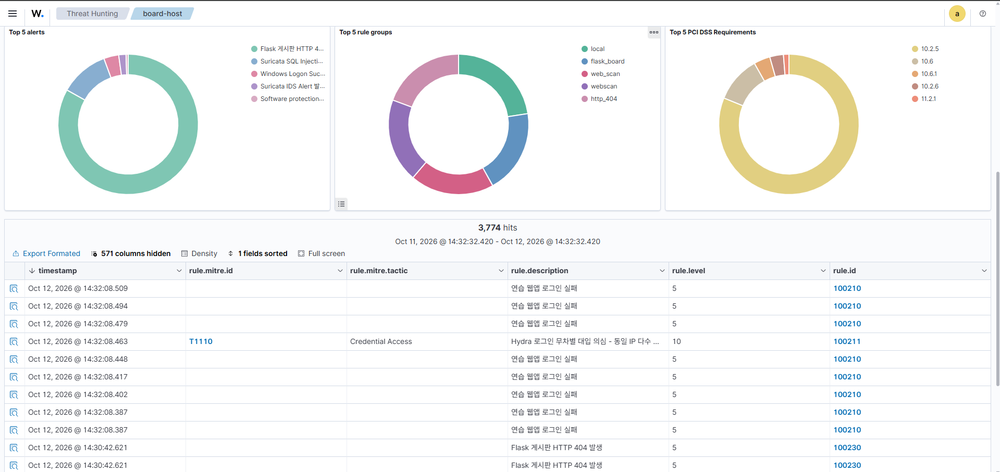
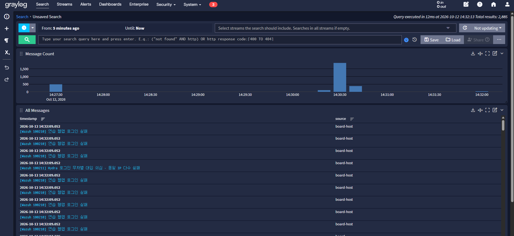
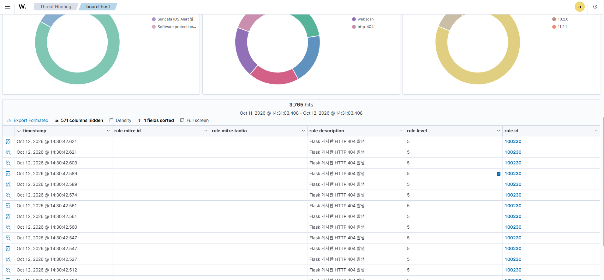
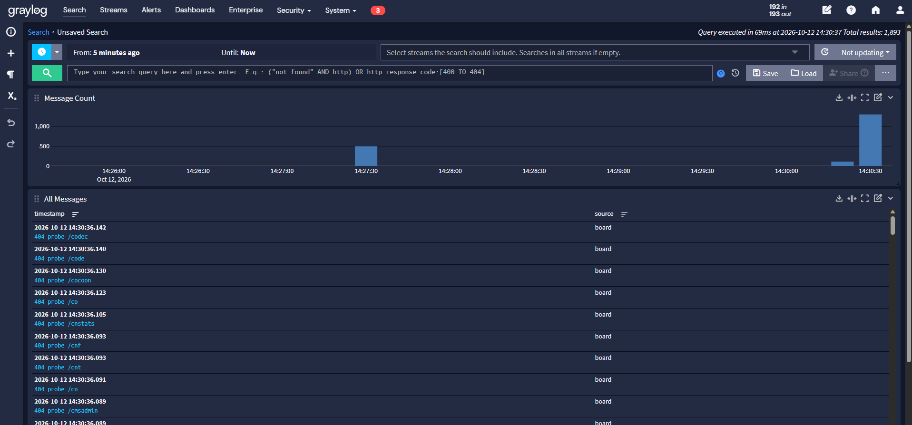
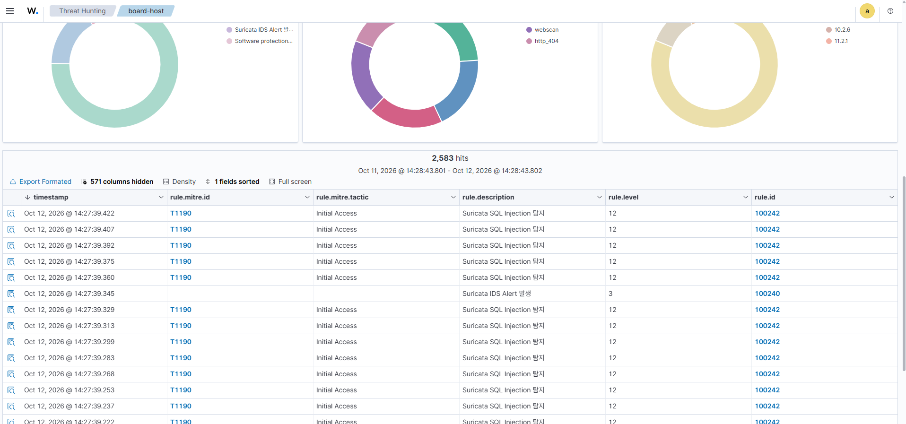
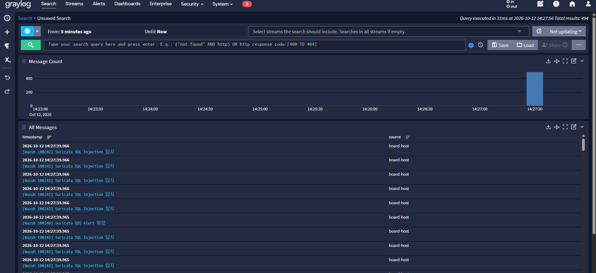
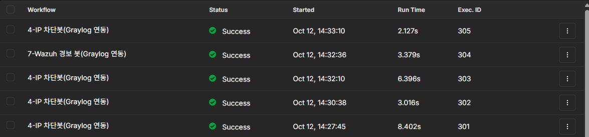
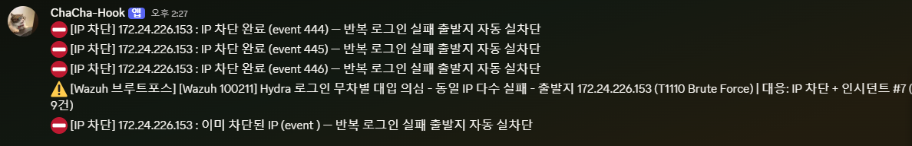
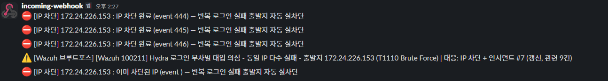
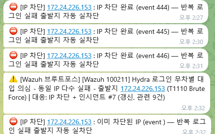

# 2026-10-12 미니실습 — Wazuh 탐지·자동 차단 결과 (chacha1650a)

3가지 공격 시나리오를 다시 실행하고 Wazuh Dashboard, Graylog, n8n, 알림 채널에서
탐지·차단 결과를 확인한 화면입니다. 적용한 Manager 설정은
[`wazuh/manager-etc/`](../../wazuh/manager-etc/)에 있습니다.

| 공격 | 디코더 | 룰 ID (level) | MITRE |
|---|---|---|---|
| ① Hydra 웹 로그인 무차별 대입 | `webapp-login` | 100210 (5) → 100211 (10) | T1110 |
| ② Nikto·디렉터리 탐색 404 폭주 | `webapp-404` | 100230 (5) → 100231 (10) | T1595 |
| ③ Nmap·SQLmap (Suricata IDS) | `suricata-alert` | 100240 (3) → 100241 (10), 100242 (12), 100243 (12) | T1046, T1190 |

## ① Hydra 웹 로그인 무차별 대입

Wazuh Dashboard — 로그인 실패 100210 누적 후 100211(T1110, level 10) 발생

Graylog — Wazuh 경보가 syslog 출력으로 Graylog에 수집됨

## ② Nikto·디렉터리 탐색

Wazuh Dashboard — HTTP 404 100230 다수 발생

Graylog — 게시판이 GELF로 보낸 `404 probe` 메시지

## ③ Nmap·SQLmap (Suricata IDS)

Wazuh Dashboard — Suricata 경보 100240 및 SQL Injection 100242(T1190, level 12)

Graylog — `[Wazuh 100242] Suricata SQL Injection 탐지` 메시지

## 자동 차단 (n8n)

`4-IP 차단봇(Graylog 연동)`, `7-Wazuh 경보 봇(Graylog 연동)` 워크플로 실행 성공

## 알림 3채널

같은 차단·경보 메시지가 Discord, Slack, Telegram에 모두 전달됨

| Discord | Slack | Telegram |
|---|---|---|
|  |  |  |

화면의 `172.24.226.153`은 실습용 WSL 내부 사설 IP입니다.
